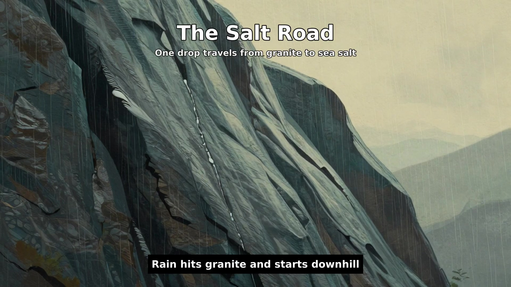

# Reelwright

[](https://pollinations.ai/?ref=badge)

**A brief in, a narrated film out.**

Reelwright is an agent skill that turns one paragraph of intent into a finished
mini-documentary: a written scene plan, an illustration per scene, a voice-over,
burned-in captions, cross-fades, a slow Ken Burns move on every shot, and a
verification pass that proves the MP4 is really playable.

Every creative step is a Pollinations API call — text, images, speech, and
speech-to-text for the final check. The only local dependency is ffmpeg.

The key you supply is your own, so every render spends from your own Pollen
balance — Reelwright never proxies traffic through someone else's account.



## The demo

**The Salt Road** — 49 seconds, five scenes, one drop of rainwater travelling from
a granite mountain to the sea.

- Watch: [`examples/salt-road/reel.mp4`](examples/salt-road/reel.mp4)
- Brief: [`examples/salt-road/brief.txt`](examples/salt-road/brief.txt)
- The plan the text model wrote: [`examples/salt-road/project.json`](examples/salt-road/project.json)
- The verification report: [`examples/salt-road/check.json`](examples/salt-road/check.json)

The demo was produced by the command in [`examples/salt-road/README.md`](examples/salt-road/README.md),
with no hand editing of the script, the images or the timeline.

## Why it is built this way

Most "AI slideshow" scripts guess how long each slide should stay on screen, then
hope the captions stay in sync. Reelwright measures instead: it ffprobes every
narration clip, builds the timeline from the real durations, and writes the
captions and the cross-fade offsets from that same timeline. A caption cannot
drift away from the sentence it belongs to, because both are placed from one
source of truth.

The `check` command is the other half of that idea. It does not trust the render
step; it reopens the finished file and asserts codec, resolution, frame rate,
duration against the plan, presence of every referenced asset, caption count, and
— with `--transcribe` — that speech-to-text of the final audio still covers at
least 80% of the script. That last check catches the failure mode that HTTP 200
cannot: an audio track that is silent, truncated or in the wrong language.

## Install

```bash
git clone https://github.com/SvirepyiBambr/pollinations-reelwright
cd pollinations-reelwright
npm install                                  # ffmpeg-static + ffprobe-static
export POLLINATIONS_API_KEY=...              # https://enter.pollinations.ai
```

Python 3.10+ and Node are enough; there are no Python packages to install.
ffmpeg is resolved in this order: `$FFMPEG`, `PATH`, `node_modules`, then
`npx ffmpeg-static`.

## Use

```bash
python3 skills/reelwright/scripts/reelwright.py make \
  --brief examples/salt-road/brief.txt \
  --out myreel \
  --scenes 5 \
  --transcribe
```

Or in steps, which is what you want when the wording matters:

```bash
python3 skills/reelwright/scripts/reelwright.py plan   --brief brief.txt --out myreel --scenes 5
$EDITOR myreel/project.json                  # fix any weak line before spending images
python3 skills/reelwright/scripts/reelwright.py render --project myreel
python3 skills/reelwright/scripts/reelwright.py check  --project myreel --transcribe
```

Useful flags: `--voice onyx|nova|alloy`, `--image-model`, `--text-model`,
`--seed` for reproducible images, `--force` to regenerate, `--scenes 3..8`.

## Output

| File | What it is |
| --- | --- |
| `project.json` | Title, subtitle, art direction, scenes, model choices. Editable. |
| `images/scNN.jpg` + `.prompt.txt` | Illustration and the exact prompt that made it. |
| `audio/scNN.mp3` | Narration per scene. |
| `clips/scNN.mp4` | Silent Ken Burns clip per scene. |
| `timings.json` | Real narration lengths, derived scene durations, start/end times. |
| `captions.ass` | Title, subtitle, per-scene captions, credit. |
| `reel.mp4`, `poster.jpg` | The deliverable and a thumbnail frame. |
| `render.json`, `check.json` | Machine-readable render and verification reports. |

## How it works

```
brief
  └─ text model ──► project.json (title, style, N scenes: caption, narration, image prompt)
       └─ per scene: image model ──► images/scNN.jpg
       └─ per scene: speech model ─► audio/scNN.mp3 ──ffprobe──► duration
            └─ timeline: scene = max(4s, narration + 0.65s)
                 └─ ffmpeg: Ken Burns clip per scene
                      └─ ffmpeg: xfade chain + ASS captions + audio concat ──► reel.mp4
                           └─ check: ffprobe assertions (+ optional transcript coverage)
```

Model defaults: `openai/gpt-5.4-nano` for the plan, `tongyi-mai/z-image-turbo` for
images, `openai/tts-1` with the `onyx` voice for narration. A five-scene reel is
five images and five short speech clips.

## Agent skill

[`skills/reelwright/SKILL.md`](skills/reelwright/SKILL.md) is written for an agent,
not a human: when to reach for the skill, the exact commands, what each output
file means, which failures are worth handling (out of pollen, text in prompts,
over-long narration, missing ffmpeg, non-Latin captions), and how to verify the
result instead of assuming it worked.

## Tests

```bash
python3 -m unittest discover -s tests -v      # 26 tests, no network, no ffmpeg
```

The suite covers the parts that silently corrupt a video: JSON extraction from a
chatty model, plan validation and repair triggers, ASS time formatting and line
wrapping, and the timeline arithmetic of the committed demo. CI runs it on every
push, so a broken caption writer fails there instead of in someone's render.

## Limits

Reelwright makes illustrated explainers, not video edits. It does not accept your
own footage, does not do talking heads, and does not cut to music. Scene count is
capped at 8 on purpose: past that, a single text-model plan starts losing the
through-line, and a human should be writing the beats.

## License

MIT
